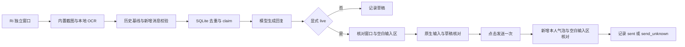

# macOS 微信自动回复

项目提供 Ri 原会话自动回复、本地联系人管理页面，以及可启动的 MCP stdio 管理服务。

| 入口 | 功能与边界 |
| --- | --- |
| `agent_loop.py --wechat-native` | 微信 2 的 Ri 独立单聊文字收发，默认 dry-run，显式 `--live` 才发送 |
| `src.core.assistant.web` | 联系人勾选、记忆与附件管理；不启动真实自动回复 |
| `src.core.assistant.mcp_server` | 7 个本地管理工具；不提供微信发送、窗口控制或任意文件读取 |
| `agent_loop.py --offline-assistant` | 离线白名单、长短期记忆、语音和文件处理；[使用说明](docs/offline-assistant.md) |

短期记忆默认保留 30 分钟内最近 12 条历史及有限摘录，总正文预算 12000 字符，支持页面、CLI 与 MCP 查看或重置。**增强记忆链尚未接入真实发送入口。** [短期记忆说明](docs/session-memory.md)。

2026-10-21 已有 Ri 真实自动回复的历史验收记录；2026-10-24 的低频配置和输入区边界修复已通过离线验证，低频完整实发闭环仍未验收。最近一次启动未识别到 Ri 独立窗口，未发送消息；账号自动退出原因未确认。执行下列命令才会启动对应程序。

## 联系人配置与身份边界

Ri 是人工指定并已完成本轮实机测试的联系人显示名。目前该目标被固定在代码中，程序只处理微信 2 的 Ri 独立单聊，不具备自动发现联系人、回复所有人或同时监听多个会话的能力。

| 项目 | 当前行为 |
| --- | --- |
| 联系人来源 | 人工指定测试联系人 Ri；需手动打开其独立窗口 |
| 会话定位 | 指定应用路径和 bundle ID，核对进程、唯一 Ri 窗口、窗口标题及几何位置 |
| 本地消息身份 | `chat_identity("Ri")` 生成 `desktop:wechat-ocr:Ri`，仅用于本地路由和去重，不是微信官方用户 ID |
| `WECHAT_OCR_CONTACT` | 原生入口只接受空值或 `Ri`；填写其他名字会拒绝启动，空值仍固定使用 Ri |
| `PERSONAL_CONTACT_NAME` | 属于企业微信兼容入口；不能用来改变原生入口的目标 |
| 同名联系人 | 未验证唯一账号身份区分能力；窗口标题不是官方身份凭据，不应仅凭同名窗口启动真实发送 |
| 其他联系人与群聊 | 不在当前实现与实机验收范围 |

固定限制的代码位置：

- `agent_loop.py` 的 `_run_wechat_native_locked`：限制配置名称，并把 `allowed_chat`、`allowed_sender` 固定为本地 Ri 身份。
- `adapters/wechat_native.py` 的 `IDENTITY`、`parse_native_frame`：固定 Ri 本地身份，核对 OCR 标题。
- `adapters/wechat_native_worker.py` 的 `NativeSession`：定位 Ri 窗口，核对原生窗口标题并执行受限操作。

**换联系人不能只改 `.env`，也不能只替换一个窗口标题。** 需要同步修改目标配置契约、原生窗口定位、OCR 标题、收发白名单和本地消息身份，并保留既有 SQLite 记录；新联系人的历史基线、去重、单次发送和未知结果不重发都需要重新验证。以上改造尚未实现。

## 环境与安装

- 已实机验收的客户端为 `/Applications/微信 2.app`，版本 4.1.15，bundle ID 为 `com.tencent.xinWeChat2`；其他版本未验证。
- macOS、Python 3.11 或更高版本，以及可访问的 OpenAI Chat Completions 兼容模型服务。
- 运行 Python 的宿主需具备屏幕录制、辅助功能权限；System Events 窗口操作还需对应自动化授权。更换终端或宿主后的权限链需重新核验。
- 微信 2 已登录，Ri 独立窗口已打开，输入区为空。运行期间保持该窗口前台，不人工操作鼠标键盘。

在本目录安装依赖；已有 `.env` 时保留原文件，不重复复制：

```bash
cd /Users/leecy/Desktop/wecom-ai-assistant/微信自动化回复
python3.11 -m venv .venv
source .venv/bin/activate
pip install -e '.[dev,assistant,mcp]'
```

首次配置时复制 `.env.example` 为 `.env`，填写 `LLM_BASE_URL`、`LLM_API_KEY`、`LLM_MODEL`，保持 `DRY_RUN=true`。密钥仅保存在本地，不提交到 Git。原生截图入口不要求填写 wx-cli 账号配置。

## MCP 管理服务

依赖为官方 `mcp==1.30.0`，作为可选依赖安装；协议与权限见 [MCP 规范](docs/mcp-spec.md)。未安装 MCP 时不影响原有微信入口与管理页面。

```bash
.venv/bin/python -m pip install -e '.[mcp]'
.venv/bin/wecom-agent-mcp --config assistant.local.json --db logs/assistant.sqlite3
```

也可使用模块入口：

```bash
.venv/bin/python -m src.core.assistant.mcp_server --config assistant.local.json --db logs/assistant.sqlite3
```

使用与管理页面相同的配置、数据库。首次使用可复制 `assistant.user.example.json` 为 `assistant.local.json`；已有文件请保留。默认白名单为空，通过页面或 CLI 手动配置后生效。

stdio 由 MCP 宿主拉起并通信，正常启动后等待 JSON-RPC 输入；stdout 只输出协议消息，日志在 stderr。宿主关闭 stdin 后退出，终端手动启动时可按 Control+C。不要把它当作 HTTP 后台服务。

[客户端配置示例](examples/assistant/mcp-client.example.json)使用通用 `mcpServers` 结构，将示例根目录替换为实际绝对路径。尚未自动安装或配置到 Codex 等宿主；不同宿主的配置文件位置和格式以宿主说明为准。

工具列表：`contacts_list`、`session_context_get`、`session_context_reset`、`memory_list`、`memory_set`、`memory_forget`、`documents_list`。先列联系人获取本地 ID，再访问已勾选联系人的数据。每次调用检查白名单；会话操作与同数据库离线监听互斥，超时或取消后不自动重试写入。

## 查看和重置短期记忆

在页面“记忆”中选择已勾选联系人，可查看近期上下文并点击“重置短期记忆”。CLI 示例：

```bash
.venv/bin/python agent_loop.py --offline-assistant session-show --config assistant.local.json --db logs/assistant.sqlite3 --conversation demo-alice --sender alice
.venv/bin/python agent_loop.py --offline-assistant session-reset --config assistant.local.json --db logs/assistant.sqlite3 --conversation demo-alice --sender alice
```

示例身份需替换为本地配置中的实际身份。`history_window` 默认 12，`short_term_ttl_seconds` 默认 1800，`short_term_max_chars` 默认 12000；完整配置范围见[短期记忆说明](docs/session-memory.md)。重置不删除审计、长期记忆、附件或发送去重记录。过期和重置前的历史不再进入短期上下文。

这些功能用于离线和桌面 `--assistant` dry-run 增强路径。桌面增强入口使用自己的 `.assistant.db`，不会自动复用网页与 MCP 指定的数据库。

## 微信 2 内置截图自动回复（Ri）

入口为 `--wechat-native`，复用 `.env` 中已配置的模型地址、密钥、模型名和 `WECHAT_OCR_TEMPLATE_NAME`。只支持 `/Applications/微信 2.app`（`com.tencent.xinWeChat2`）已打开的 `Ri` 独立单聊。先在联系人列表双击 Ri 打开独立窗口。

```bash
cd /Users/leecy/Desktop/wecom-ai-assistant/微信自动化回复
DB_URL=sqlite:///./logs/wechat-native.db .venv/bin/python agent_loop.py --wechat-native --once
DB_URL=sqlite:///./logs/wechat-native.db .venv/bin/python agent_loop.py --wechat-native --live
```

第一条为不发送的单轮预检；第二条启用本人原会话自动回复。也可双击 `启动微信自动回复.command`，启动真实自动回复，轮次之间默认等待 60 秒。在启动终端按 Control+C 停止；跨进程锁阻止两个 wx2 桌面执行器同时运行。

启动时将 Ri 独立窗口设为 598×640 并居中，读取当前可见消息作为基线，不补发旧消息或旧草稿。后续只处理严格尾部追加的对方文字，忽略本人消息；保留原始显示时间，不补造年份和秒数。所有入站 claim、回复和结果持久化到指定 SQLite，重复消息和未知发送不会重发。

采集使用 Control+Command+A 打开微信内置截图覆盖层，只采集 Ri 窗口矩形，随后退出截图。OCR 在本机运行。运行中保持 Ri 独立窗口在前台且位置不变，不要同时操作它；切换应用、切换窗口、移动窗口、出现人工草稿或消息前缀不再完整时，该轮不发送。窗口截图会短暂显示截图选区界面。

采用原生 Unicode 按键输入，不读写系统剪贴板。发送依次校验精确进程/窗口、Ri 标题、空白输入区、完整草稿、历史未变和唯一发送按钮，再点击发送一次。只有新增本人绿色气泡与草稿匹配且输入区清空，才记录 `sent`（仅表示本机提交确认）。文字写入开始后的超时、取消和不确定结果记录 `send_unknown`，不自动重发。

支持范围为已验证布局中的可辨认文字。图片、语音、视频、表情、群聊、后台/最小化和其他联系人不在本次验收范围；OCR 歧义与缺少时间分隔时停止该轮。可见历史因正常滚动不完整时，当前运行入口不自动滚动补扫历史；无法确认完整前缀时停止本次运行，不把残缺视口直接当作新历史。

2026-10-21 已实机确认：Ri 独立窗口可打开、正文可采集，识别出 2 条对方及 3 条本人消息；固定测试文字已在本机提交并确认新增气泡。19:39 的新消息“你是谁”触发真实模型回复并在原会话提交；首次回执因头像和截断行 OCR 误判而记录未知，修复后只读核对确认完整 5 条前缀、新增 1 条匹配本人气泡和空白输入区，更新为 `sent`，没有重发。完整事实、旧未知记录及未验证范围见 `docs/native-wechat-validation.md`。


## 兼容入口与证据边界

| 入口 | 接入方式 | 本次状态 |
| --- | --- | --- |
| `--wechat-native` | 微信 2 内置截图、本地 OCR、原生输入与单次发送 | 本次实机跑通；最终回执经过修复后只读核对 |
| `--wechat-ocr` | wx-cli 历史变化检测与窗口 OCR | 账号初始化阻塞，未完成本次实机闭环 |
| `--personal` | 企业微信 Ri 外部单聊的已打开聊天记录面板 | 保留兼容入口，不作为微信 2 的启动前提 |
| `--wechat` / `--wechat-login` | 官方 iLink 机器人通道及登录 | 保留兼容入口；不作为本人原会话发送的验收证据 |
| 默认 CLI、FastAPI、Redis Stream、自建应用 | 原有 CLI 与服务端兼容模块 | 本次微信 2 路径不依赖这些模块 |

2026-10-21 实测 wx-cli 0.3.0 的 `init` 与 `init --force` 均返回“未能自动检测到微信数据目录”，未生成 wx2 密钥文件，`WX_CLI_ACCOUNT_VERIFIED` 继续保持 `false`。旧 OCR 路径要求实际核实 `config.json`、wx2 数据目录、密钥、账号与历史元信息；不能通过改成 `true` 绕过核验，也不会回退读取另一账号。

企业微信兼容入口需先打开 `Ri @微信` 单聊中的“查找聊天记录”，清空搜索框并保持默认筛选：

```bash
.venv/bin/python agent_loop.py --personal
```

上式默认为 dry-run。该路径的独立授权 live 入口是 `--personal --live`，不与 `--wechat-native` 混用；群聊和其他联系人不在授权范围。企微日志查看器为 `.venv/bin/python -u watch_logs.py`，只读日志和数据库。

## 实现入口

| 文件 | 职责 |
| --- | --- |
| `agent_loop.py` | `run_wechat_native`：运行锁、模型配置、启动基线和消息循环 |
| `adapters/wechat_native.py` | `NativeRiChat`：OCR 快照、历史衔接、收件和发送回执 |
| `adapters/wechat_native_worker.py` | `NativeSession`：隔离的原生窗口、截图、滚动与键鼠操作 |
| `adapters/personal_tail.py` | `PersonalTailInbox`：历史基线与严格尾部追加 |
| `prompts/wechat_ocr_reply.txt` | 原生截图路径的回复提示词，由配置模板名加载 |
| `tests/test_wechat_native*.py` | 原生路径的单元测试与运行入口测试 |
| `smoke/smoke_wechat_native.py` | 模拟截图、mock 模型、真实 SQLite 与模拟发送的离线闭环 |



## 运行记录与验收

| 文件 | 内容 |
| --- | --- |
| `logs/wechat-native.db` | 入站基线、去重、模型回复与发送结果 |
| `logs/wechat-native.log` | 本轮直接启动进程的运行日志；手动前台命令默认输出到终端 |
| `logs/wechat-native-process.json` | 本轮直接启动进程的 PID 与状态；不是所有启动方式的统一进程管理器 |
| `logs/native-channel-manual-test.json` | 固定文字发送通道的实机记录 |
| `logs/native-auto-reconciliation.json` | 自动回复首次未知状态及后续只读核对记录 |

[完整实机验收记录](docs/native-wechat-validation.md)保留测试经过、历史未知发送和未验证项。2026-10-21 的实现检查记录为 pytest 收集 835 / 通过 835、ruff 通过、离线冒烟通过；这是该次检查结果，后续修改需重新执行。

双击 `启动微信自动回复.command` 会请求运行 live，但 Finder → Terminal 的双击启动与权限链尚未完成实机验收。该脚本只通过了语法检查；已验证的真实运行使用本会话直接启动的进程。在启动终端按 Control+C 停止后，需确认进程退出。停止不会删除 SQLite 去重和未知发送记录。

## 配置

| 参数 | 说明 | 默认值 |
| --- | --- | --- |
| `DRY_RUN` | 是否只生成草稿。个人入口以 `--live` 显式开启发送 | `true` |
| `INBOX_BACKEND` | 接收后端；个人桌面接入设为 `personal`，或使用 `--personal` | `cli` |
| `PERSONAL_CONTACT_NAME` | 已验证的个人单聊显示名 | `Ri` |
| `LLM_BASE_URL` | OpenAI Chat Completions 兼容 API 地址 | 无 |
| `LLM_API_KEY` | 模型服务密钥，仅保存在本地 `.env` | 无 |
| `LLM_MODEL` | 模型名称 | 无 |
| `PERSONAL_LLM_TEMPLATE_NAME` | `prompts/` 中的个人回复模板文件名 | `personal_reply.txt` |
| `DB_URL` | SQLite 处理记录数据库 | `sqlite:///./agent.db` |
| `POLL_INTERVAL_SECONDS` | 兼容入口轮询间隔（秒），不控制原生截图入口 | `2` |
| `WECHAT_NATIVE_POLL_SECONDS` | 原生微信轮询间隔，允许 30–600 秒 | `60` |
| `WECHAT_ILINK_ALLOWED_USER` 等 iLink 变量 | 仅官方 iLink Bot API 路径（`--wechat`）需要 | 见 `.env.example` |
| `WECHAT_OCR_CONTACT` | 旧 OCR 路径的联系人配置；原生入口只接受空值或 `Ri`，不支持任意联系人 | 无 |
| `WECHAT_OCR_TEMPLATE_NAME` | `prompts/` 中的 OCR 回复模板文件名 | `wechat_ocr_reply.txt` |
| `WX_CLI_WORKDIR` | 已核实的 wx2 CLI 配置目录 | `.` |
| `WX_CLI_ACCOUNT_VERIFIED` | wx2 数据来源和当前账号已实际核实 | `false` |

## 测试

```bash
source .venv/bin/activate
pytest -v
ruff check .
python smoke.py
```

`smoke.py` 默认只执行离线验证，不会操作真实微信或企业微信，不会发送真实消息。


## 自动回复流程图

[打开交互式流程图](docs/diagrams/ri-auto-reply.html)（支持缩放、明暗主题和导出）。源文件与 HTML 均保存在项目 `docs/diagrams/` 中。

## 用户管理：白名单、记忆和附件

[完整操作说明](docs/assistant-user-management.md)包含初始化空白白名单、添加/移除会话、记忆有效期、附件提交与移除的可复制命令。新增 `assistant.user.example.json` 默认白名单为空；使用个人配置文件 `assistant.local.json`，不修改演示配置。

- 白名单支持手动添加、删除、查看；离线 `watch` 会重新加载配置，移除的会话停止处理排队消息，重新添加后仍需显式恢复。
- 记忆支持按会话查看、设置、删除及有效期；附件支持手动提交、查看解析资料与移除检索资料。
- 这些管理入口属于离线助手，不自动绑定微信联系人，也不扩大原生 Ri 真实发送范围。管理数据库时需先停止同一数据库的 `watch`；白名单修改可在运行中执行。
- 原生 `--wechat-native` 入口现在始终以本次 `--live` 参数决定发送模式；`.env` 的 `DRY_RUN=false` 不会单独开启真实发送。

## 联系人勾选页面

提供本地联系人管理界面，支持搜索、批量勾选、保存白名单、刷新回显以及会话记忆与附件资料管理。[启动与使用说明](docs/contact-ui.md)。地址为 `http://127.0.0.1:8765`，页面不会启动真实微信自动回复。

## 启动和退出管理页面

首次安装、日常启动和常见问题见[启动说明](docs/contact-ui.md#首次安装)。日常可双击 `启动联系人管理.command`，或执行：

```bash
.venv/bin/python -m src.core.assistant.web --config assistant.local.json --db logs/assistant.sqlite3
```

访问 `http://127.0.0.1:8765`。退出时点击页面右上角“退出程序”并确认，或在启动终端按 Control+C。按钮只关闭本地管理服务，保留已保存数据；关闭标签页不会停止服务。再次使用需重新启动。

## 原生微信低频运行

本机 `.env` 已设置 `WECHAT_NATIVE_POLL_SECONDS=60`。原生入口每轮结束后等待 60 秒，不再使用兼容入口的 `POLL_INTERVAL_SECONDS`。可在 `.env` 改为 30 至 600 秒，修改后下次启动生效；实际新消息响应还包括截图、OCR、模型与校验耗时。

截图读取不自动重试；历史前缀不完整时不自动滚动补扫；收件、模型、草稿或发送校验失败后停止本次运行。不会自动重启监听或补发旧消息。发送前后的身份、输入框与新增气泡校验仍执行。

本次只做离线回归验证，不再次触发真实消息测试。降低频率是否能避免客户端自动退出尚未验证，不将其描述为已修复账号退出原因。

## 本次交付检查

pytest：收集 1017 / 通过 1017；ruff：通过。`smoke.py` 通过，包含官方 MCP 客户端初始化、7 个工具发现、记忆读写、短期重置与撤权验证，真实发送数为 0。存在两条既有依赖弃用告警。

MCP 宿主界面连接、新增记忆控件的浏览器点击及低频真实发送完整闭环尚未验收。历史实机结果不代表本次修改已完成实发验证。
